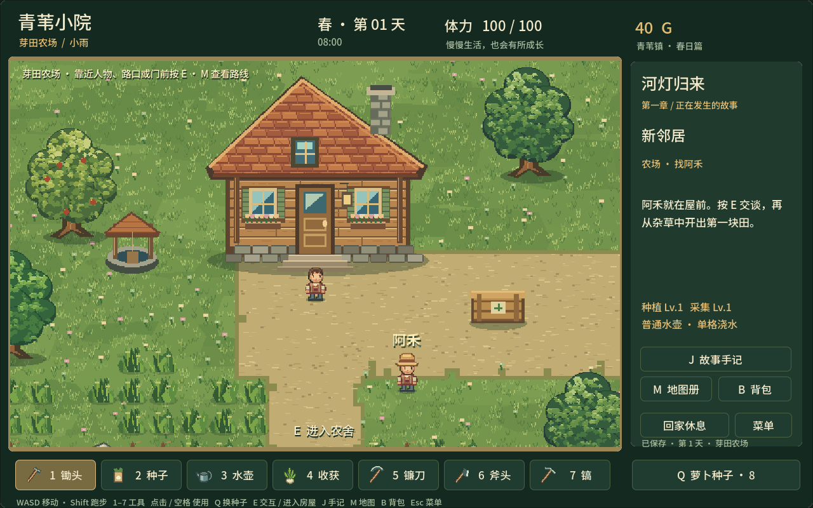

# 芽田农场 · 河灯归来

Godot 4.7.2 / GDScript 的 PC 单机开发原型。当前可从标题、创建角色一路玩到第一章结尾，再继续开垦、种植、交友和升级工具。

## 直接试玩

克隆工程，用 Godot 4.7.2 标准版导入 `project.godot`，按 F5 运行：

```sh
git clone https://github.com/Skywang16/gamedemo.git
cd gamedemo
```

macOS 也可执行 `./launch.command`。脚本优先使用 `GODOT_BIN`，其次寻找本工作区的 Godot、`/Applications/Godot.app` 或 PATH 中的 `godot`。像素素材、字体和音效已包含在工程中，直接运行不需要 Python。

本地打包后，可打开上一级目录生成的 `Sprout Valley.app`，选择「开始新生活」。开发期不兼容旧存档；创建新角色后直接替换当前存档，不制作备份。



## 第一天

1. 创建姓名、农场名、肤色、发色、衣服和帽子，阅读祖母来信。
2. 屋前找阿禾，按 E 交谈。农场最初只有草地、杂草、木枝、石块和树木，没有翻好的田和预种作物。
3. 5 镰刀清草、6 斧头清理木枝、7 镐清理碎石。鼠标点击身边一格，或按空格使用面朝方向的工具。清理得到纤维、木材、石料，清理结果永久保留。
4. 清地后，1 翻土、2 播种、3 浇水。Q 切换种子。萝卜需要 3 个浇水日，胡萝卜需要 4 个浇水日；干旱日不生长。
5. 农舍门口按 E 进入室内，在床边休息；也可点「回家休息」。翌日在屋内醒来。4 收获成熟作物。
6. 右侧故事手记显示目标，J 看完整任务线。至少种 4 份萝卜能完成第一章的两次交付；多种的可以卖给屋前收货箱。

WASD / 方向键移动，Shift 跑步，E 交互 / 进屋，M 打开当前地图和入口标记，B 背包，Esc 暂停。菜单与对话暂停时间。

## 已实现

- 96×72 格农场（3072×2304 像素）、80×56 格小镇、80×64 格森林、88×60 格湖畔；室外镜头跟随，屏幕界面固定，鼠标正确换算世界坐标。
- 农舍、小馆、工坊三张独立室内；房门进入、门口返回、真实碰撞。地图册显示本人、村民和交互点。
- 清荒、两种作物、每日浇水生长、收获、购买种子、出售作物、体力、日夜色调、休息、自动 / 手动保存。
- 四位村民、上午 / 下午两个位置、每日交谈与赠礼、关系 40 的专属回忆与一次性回礼。
- 种植 / 采集经验；种植 2 级升级铜水壶，一次浇三格；采集 3 级增加野外采集产量；储物箱；野莓粥恢复体力。
- 第一章完整剧情：欢迎 → 分享收成 → 采集修桥 → 湖边手记 → 准备聚餐 → 河灯心愿；修桥解锁湖畔，结局改变湖面与人物对白。
- 原创像素素材由 Python / Pillow 直接绘制：独立透明角色、作物、树木、建筑、杂物和道具。地形背景是地图数据的渲染结果，交互对象和碰撞独立。

第二、三章只有剧情大纲。当前没有季节轮替、钓鱼、战斗、婚恋或牲畜养殖；场景大树是静态障碍，可清理的是枯枝与碎石。当前可开发、可游玩，但内容和美术还需继续打磨。

## 目录与职责

```text
src/
  game.gd              # 启动、输入路由、时间、区域切换与系统协调
  core/                # 配置读取与索引；可序列化状态
  gameplay/            # 清荒、种植、睡眠、买卖规则
  story/               # 任务推进、社交、采集、技能、烹饪、储物规则
  world/               # 角色移动、碰撞、镜头、物件与绘制
  ui/                  # 共用视觉组件、标题 / 创建、游戏界面、地图册
  persistence/         # 文件读写与存档入口校验
scenes/                # Godot 主场景
data/                 # 物品、作物、人物和剧情
  maps/                # 地图索引和每张地图独立 JSON
assets/                # 游戏直接使用的 PNG、字体、音效
tools/
  build_art.py         # 素材重建入口
  art/                 # 人物、环境、地形、室内、作物和道具绘制
  world/build_layouts.py # 确定性室外地图生成
  package_macos.py     # macOS 开发包
tests/                # 规则、剧情与原生窗口集成测试
screenshots/           # 实际运行截图
```

数据入口校验一次，内部系统使用已经验证的状态。玩法规则不依赖场景树，不负责文件读写。素材生成器不参与游戏运行。

## 开发与验证

```sh
python3 -m venv .venv
.venv/bin/pip install -r requirements-dev.txt
.venv/bin/python tools/world/build_layouts.py
.venv/bin/python tools/build_art.py

godot --headless --editor --path . --import
godot --headless --path . --script res://tests/test_runner.gd
godot --headless --path . --script res://tests/chapter_tests.gd
godot --path . --script res://tests/ui_smoke.gd -- --save-dir=user://ui-test-UNIQUE

.venv/bin/gdformat --check src tests
.venv/bin/ruff check tools
.venv/bin/ruff format --check tools
```

UI 测试必须使用新的 `ui-test-` 目录名；需要图形桌面。测试会操作输入、保存截图；跨大区域通过定位角色缩短步行时间，不能替代真人对节奏和手感的体验。测试不修改正常存档。

正常存档在 macOS `~/Library/Application Support/SproutValleyDemo/farm.json`。当前格式为 schema 3；只支持当前结构，临时文件写完后替换主文件。地图和结构发生破坏性修改时直接开新档，不编写迁移分支。

```sh
python3 tools/package_macos.py /absolute/path/to/Godot
```

这个 `.app` 使用 Godot 可执行文件加 PCK，是本地开发包；正式分发应改用导出模板和正式签名流程。

人物设定与后续章节见 `STORY_DESIGN.md`；架构见 `DESIGN.md`；实际验收见 `VALIDATION.md`。原创绘制代码与游戏素材在工程内，字体及 Godot 的许可证位于 `assets/fonts/OFL.txt` 和 `licenses/`。
