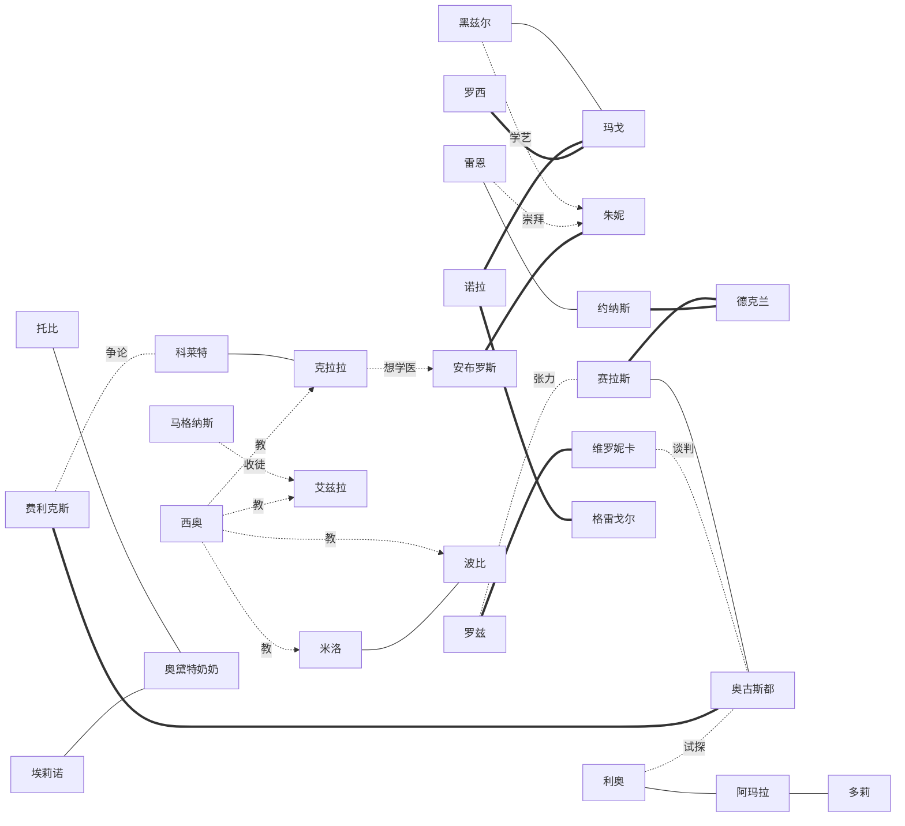

# 08 · 人物、家庭与人际关系

## 1. 一眼看懂

- **30 位村民 + 祖母西尔维娅**：村民中女 16、男 14。可恋爱 12 人，6 女 6 男；结婚后对方搬进农舍。西尔维娅是登场的来宾，不在村民名单里。
- **年龄**：少年儿童 4、青年（18–39 岁）14、中年（40–59 岁）7、长者（60 岁以上）5（见 §3）。
- **9 个家庭**加 7 位独居或外来者，婚姻状态各不相同：已婚、丧偶、单亲抚养、养女、祖孙、舅甥 / 姑侄、三代同堂、师徒、独居。
- **每个人至少与 3 个人有明确关系**；每个家庭内部至少有一处“没说出口的话”，这是剧情的来源。
- 姓氏体现家庭，同一家庭同姓；收养、舅甥、姑侄的姓氏不同以体现关系。名字、英文名和译名规则见 [11-western-setting.md](11-western-setting.md)。

## 2. 人物总表

★ = 可恋爱。生日、喜好和心事件见 [02-cast.md](02-cast.md)。

| 编号 | 姓名 | 性别 | 年龄 | 家庭 | 身份 | 主要场所 |
| --- | --- | --- | --- | --- | --- | --- |
| hazel | 黑兹尔 ★ | 女 | 26 | 独居（西尔维娅的“半个孙女”） | 种子商 | 农场 |
| silas | 赛拉斯 ★ | 男 | 34 | 卡弗家（母亲埃莉诺、姐姐罗兹） | 木匠 | 木工坊 |
| margot | 玛戈 ★ | 女 | 29 | 阿什比家（带着外甥米洛） | 小酒馆老板 | 小酒馆 |
| wren | 雷恩 ★ | 女 | 22 | 独居（孤女，由姨母带大） | 湿地鸟类记录员 | 湖畔 |
| juniper | 朱妮 ★ | 女 | 31 | 惠特洛克家（安布罗斯的徒弟） | 草药师 | 诊所、林地 |
| leo | 利奥 ★ | 男 | 24 | 无家（意大利裔行脚商人） | 行脚商人 | 集市街 |
| felix | 费利克斯 ★ | 男 | 30 | 独居（德裔） | 钟表匠 | 集市街 |
| colette | 科莱特 ★ | 女 | 25 | 奎尔家（巴纳比的养女，法裔） | 剧团女演员 | 小镇、集市街 |
| jonas | 约纳斯 ★ | 男 | 32 | 弗林—霍尔沃森家（梅芙之子） | 巡林员 | 林地 |
| nora | 诺拉 ★ | 女 | 27 | 德尔加多家（罗西的侄女，西班牙裔） | 茶室老板 | 铜壶茶室 |
| theo | 西奥 ★ | 男 | 35 | 独居（瑞典裔） | 小学教师 | 小镇学校 |
| declan | 德克兰 ★ | 男 | 33 | 布兰尼根家（马格纳斯的外甥，爱尔兰裔） | 采石矿向导 | 矿洞、林地 |
| augustus | 奥古斯都 | 男 | 67 | 彭伯顿家（鳏夫） | 镇长 | 小镇 |
| clara | 克拉拉 | 女 | 17 | 彭伯顿家（孙女） | 学生，想学医 | 小镇、诊所 |
| maeve | 梅芙 | 女 | 58 | 弗林—霍尔沃森家（托比之女） | 前河运船主 | 海鸥湾 |
| toby | 托比 | 男 | 72 | 弗林—霍尔沃森家 | 前摆渡人、渔具店 | 渔具店 |
| roz | 罗兹 | 女 | 38 | 卡弗家 | 县水利局测绘员 | 县里（章节后回镇） |
| eleanor | 埃莉诺 | 女 | 66 | 卡弗家 | 退休织工 | 木工坊、茶室 |
| gregor | 格雷戈尔 | 男 | 48 | 霍克家 | 杂货店老板 | 杂货店 |
| dolly | 多莉 | 女 | 49 | 霍克家 | 菜贩、消息通 | 集市街 |
| ezra | 艾兹拉 | 男 | 16 | 霍克家（长子） | 铁匠学徒 | 集市街、铁匠铺 |
| poppy | 波比 | 女 | 8 | 霍克家（幼女） | 小学生 | 集市街、学校 |
| milo | 米洛 | 男 | 10 | 阿什比家（玛戈的外甥） | 小学生、酒馆跑腿 | 小镇 |
| magnus | 马格纳斯 | 男 | 50 | 布兰尼根家（鳏夫） | 铁匠 | 铁匠铺 |
| ambrose | 安布罗斯 | 男 | 55 | 惠特洛克家（鳏夫） | 诊所医生 | 诊所 |
| rosa | 罗西 | 女 | 50 | 德尔加多家（单亲抚养侄女） | 牧场主 | 牧场 |
| amara | 阿玛拉 | 女 | 29 | 独居（尼日利亚裔） | 邮差 | 全镇巡游 |
| barnaby | 巴纳比 | 男 | 60 | 奎尔家（丧偶） | 剧团团长 | 小镇、集市街 |
| odette | 奥黛特奶奶 | 女 | 80 | 奎尔家（巴纳比之母） | 独居老人 | 小镇长椅 |
| veronica | 维罗妮卡 | 女 | 41 | 已婚，家在县城 | 县规划办干部 | 县里（章节后回镇） |
| sylvia | 西尔维娅 | 女 | 63 | 玩家的祖母 | — | 信里；第三章的灯夜回到镇上 |

## 3. 年龄与性别分布

| 年龄段 | 女 | 男 |
| --- | --- | --- |
| 0–17 岁 | 波比 8、克拉拉 17 | 米洛 10、艾兹拉 16 |
| 18–29 岁 | 黑兹尔、玛戈、雷恩、科莱特、诺拉、阿玛拉 | 利奥 24 |
| 30–39 岁 | 朱妮 31、罗兹 38 | 赛拉斯、费利克斯、约纳斯、西奥、德克兰 |
| 40–59 岁 | 多莉 49、罗西 50、梅芙 58、维罗妮卡 41 | 格雷戈尔 48、马格纳斯 50、安布罗斯 55 |
| 60 岁以上 | 埃莉诺 66、奥黛特奶奶 80 | 巴纳比 60、奥古斯都 67、托比 72 |

玩家能认识从 8 岁到 80 岁的人，每个年龄段都有可以做朋友的人。

## 4. 家庭结构图

实线 = 血缘 / 婚姻；虚线 = 收养 / 抚养 / 师徒。

```mermaid
graph TD
  subgraph 卡弗家["卡弗家（木匠世家）"]
    父["卡弗先生（已故，修桥人）"]
    埃莉诺["埃莉诺 F66"]
    赛拉斯["赛拉斯 M34"]
    罗兹["罗兹 F38"]
    父 --- 埃莉诺
    埃莉诺 --> 赛拉斯
    埃莉诺 --> 罗兹
  end
  subgraph 阿什比家["阿什比家"]
    玛戈["玛戈 F29"]
    米洛["米洛 M10"]
    姐["玛戈之姐（在外地工作）"]
    姐 --> 米洛
    玛戈 -. 照看 .-> 米洛
  end
  subgraph 霍克家["霍克家（杂货店）"]
    格雷戈尔["格雷戈尔 M48"]
    多莉["多莉 F49"]
    艾兹拉["艾兹拉 M16"]
    波比["波比 F8"]
    格雷戈尔 --- 多莉
    格雷戈尔 --> 艾兹拉
    格雷戈尔 --> 波比
    多莉 --> 艾兹拉
    多莉 --> 波比
  end
  subgraph 渡口家["弗林—霍尔沃森家（三代摆渡人）"]
    托比["托比 M72"]
    梅芙["梅芙 F58"]
    约纳斯["约纳斯 M32"]
    托比 --> 梅芙
    梅芙 --> 约纳斯
  end
  subgraph 奎尔家["奎尔家（剧团）"]
    奥黛特["奥黛特奶奶 F80"]
    巴纳比["巴纳比 M60"]
    科莱特["科莱特 F25"]
    奥黛特 --> 巴纳比
    巴纳比 -. 养女 .-> 科莱特
  end
  subgraph 德尔加多家["德尔加多家（牧场）"]
    罗西["罗西 F50"]
    诺拉["诺拉 F27"]
    罗西 -. 抚养侄女 .-> 诺拉
  end
  subgraph 布兰尼根家["布兰尼根家（铁匠铺）"]
    马格纳斯["马格纳斯 M50"]
    德克兰["德克兰 M33"]
    马格纳斯 -. 舅舅 .-> 德克兰
  end
  subgraph 彭伯顿家["彭伯顿家（镇长）"]
    奥古斯都["奥古斯都 M67"]
    克拉拉["克拉拉 F17"]
    奥古斯都 --> 克拉拉
  end
  subgraph 惠特洛克家["惠特洛克家（诊所）"]
    安布罗斯["安布罗斯 M55"]
    朱妮["朱妮 F31"]
    安布罗斯 -. 师徒 .-> 朱妮
  end
```

| 类型 | 家庭 | 说明 |
| --- | --- | --- |
| 三代同堂 | 弗林—霍尔沃森家 | 三代摆渡人，母子之间有“不愿让他再冒险”的心结 |
| 母亲 + 姐弟 | 卡弗家 | 埃莉诺调停，姐弟因“留与走”多年少联系 |
| 夫妻 + 两个孩子 | 霍克家 | 唯一完整的核心家庭，孩子一个少年一个幼童 |
| 母子 + 养女 | 奎尔家 | 奥黛特奶奶记忆渐淡，巴纳比照顾母亲，科莱特是剧团养大的孤女 |
| 姑侄 / 舅甥 | 德尔加多家、布兰尼根家、阿什比家 | 代人抚养，各有一位“替人长大的孩子” |
| 祖孙 | 彭伯顿家 | 克拉拉父母在外，由祖父带大 |
| 师徒 | 惠特洛克家 | 安布罗斯与朱妮，医者传承 |
| 单身与外来者 | 黑兹尔、雷恩、西奥、费利克斯、阿玛拉、利奥、维罗妮卡 | 玩家最容易走近的一群 |

## 5. 人际关系网（跨家庭）

线型：— 朋友 / === 工作往来 / -.-> 师生或崇拜 / -.- 张力。

祖母西尔维娅与黑兹尔、雷恩、梅芙、奥古斯都、奥黛特奶奶都是旧识，她的信把这些人连在一起。

最有戏的几条线：

| 线 | 内容 | 对应故事 |
| --- | --- | --- |
| 罗兹 ↔ 赛拉斯（埃莉诺调停） | 姐姐当年离开，弟弟留下扛承诺；母亲夹在中间 | 后续章节的水渠、和解 |
| 维罗妮卡 ↔ 罗兹 | 同在县里，搬迁方案里有罗兹的勘测数据 | 水库搬迁计划 |
| 维罗妮卡 ↔ 奥古斯都 | 一个要报告，一个守着镇子，两边都有道理 | 小镇会议 |
| 托比 ↔ 梅芙 ↔ 约纳斯 | 三代摆渡人，摆渡灯人的秘密在最老的一代 | 摆渡灯人真相 |
| 巴纳比 ↔ 奥黛特奶奶 ↔ 科莱特 | 剧团要散，母亲在忘，养女在选择 | 戏灯、剧院之夜 |
| 马格纳斯 ↔ 德克兰 ↔ 约纳斯 | 矿洞里失去的搭档，由舅舅和同伴一起走出来 | 旧采石矿 |
| 黑兹尔 ↔ 西尔维娅 ↔ 玩家 | 西尔维娅的“半个孙女”如何面对“真孙辈”的到来 | 黑兹尔的事件 |
| 格雷戈尔 ↔ 多莉 ↔ 艾兹拉 | 赊账的账本、传话的嘴、想学手艺的少年 | 霍克家的事件 |

## 6. 各家的“没说出口的话”

| 家庭 | 没说出口的话 | 一个能让玩家参与的小事 |
| --- | --- | --- |
| 卡弗家 | 埃莉诺一直把罗兹寄来的钱存着，想让两个孩子一起用来修桥 | 帮埃莉诺把存折转交给赛拉斯 |
| 阿什比家 | 米洛的妈妈每次来电都说“下个月就回”，玛戈不忍心拆穿 | 陪米洛写一封信 |
| 霍克家 | 格雷戈尔悄悄赊账给困难户，账本厚得像砖；多莉其实知道 | 帮格雷戈尔对账 |
| 弗林—霍尔沃森家 | 梅芙把搁浅的船瞒着全家；约纳斯也没告诉母亲为什么离开救援队 | 陪约纳斯把话说开 |
| 奎尔家 | 奥黛特奶奶偶尔清醒，总问“灯放了吗”；巴纳比怕剧团散了母亲没处可去 | 陪奥黛特奶奶放一盏灯 |
| 德尔加多家 | 诺拉的母亲（罗西的妹妹）出走时留了一封信，罗西没拆 | 把信的内容读给诺拉 |
| 布兰尼根家 | 德克兰的搭档遇难时，马格纳斯在外地进货，一直自责 | 与德克兰、马格纳斯一起刻碑 |
| 彭伯顿家 | 克拉拉想学医，奥古斯都盼她回镇接班 | 帮克拉拉写志愿表 |
| 惠特洛克家 | 安布罗斯想退休，没有人接班；朱妮不敢说自己愿意留下 | 帮朱妮递交辞职信（给医院的，不是给安布罗斯的） |

## 7. 喜好的依据

每个人的最爱、喜欢、讨厌各取自人物性格和职业：铁匠和矿洞向导爱矿物与烤鱼；医者爱草药与茶；牧场主爱干草和蛋；孩子爱甜食和野莓；老人爱旧物与热汤；教师爱书与茶。规则见 [04-systems.md](04-systems.md) 的好感与送礼。
