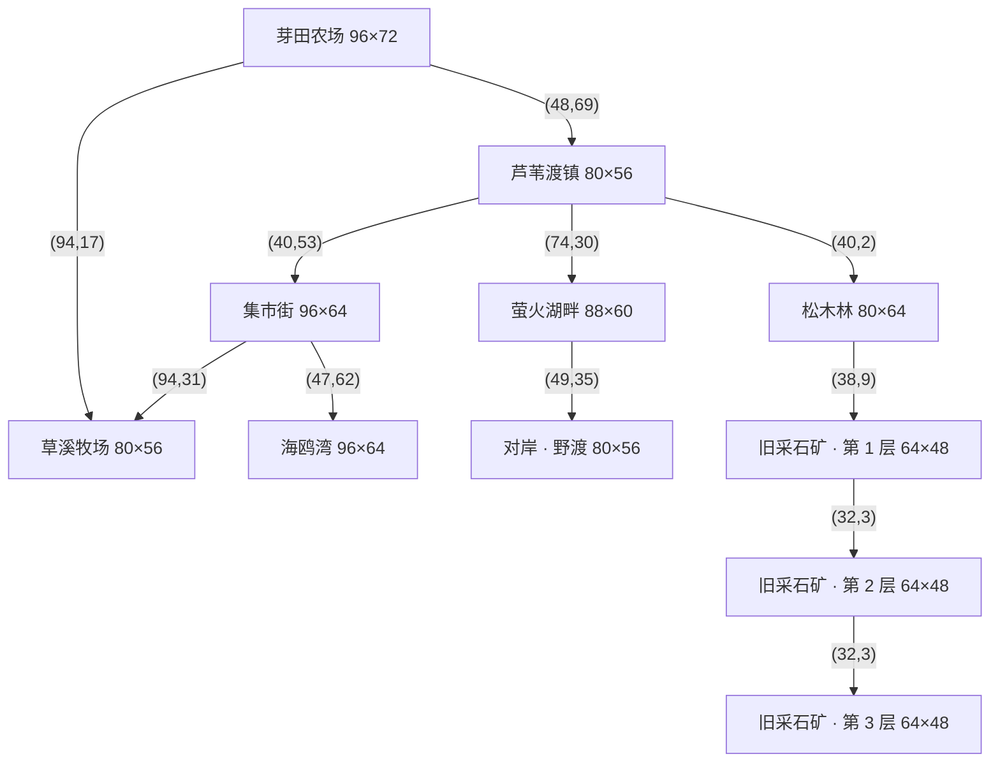

# 09 · 世界地图与路网

本文的表格由 `tools/world/build_map_doc.py` 从 `data/maps/` 生成。地图本身由 `tools/world/build_maps.py` 从零生成（每次运行都完整重写）。

## 1. 总连通图

所有地图通过真实的道路相连，每条边在两端各有一个出口站点（交互提示“北行 · 芦苇渡镇”之类）。

读法：**农场是中心，向南进镇；镇向北进山（林地与矿洞），向南进集市街，向东过桥到湖；集市街向东通牧场（牧场又有一条路直通农场），向南通海边。** 农场—镇—集市街—牧场构成一个闭环，不用走回头路。小镇到萤火湖畔的桥在主线阶段 3（修好东桥）之后才通。

## 2. 地图总表

| 地图 | 尺寸（格） | 地面 | 路面 | 树 | 采集点 | 装饰 | 站点 |
| --- | --- | --- | --- | --- | --- | --- | --- |
| 芽田农场 | 96×72 | 草地 | 土路 | 212 | 0 | 15 | 5 |
| 芦苇渡镇 | 80×56 | 草地 | 石板 | 90 | 0 | 31 | 7 |
| 集市街 | 96×64 | 草地 | 石板 | 60 | 0 | 111 | 7 |
| 草溪牧场 | 80×56 | 草地 | 土路 | 80 | 0 | 31 | 3 |
| 海鸥湾 | 96×64 | 沙滩 | 木栈道 | 24 | 22 | 25 | 2 |
| 松木林 | 80×64 | 草地 | 土路 | 270 | 24 | 12 | 2 |
| 萤火湖畔 | 88×60 | 草地 | 土路 | 110 | 10 | 7 | 3 |
| 对岸 · 野渡 | 80×56 | 草地 | 土路 | 80 | 20 | 7 | 2 |
| 旧采石矿 · 第 1 层 | 64×48 | 洞窟 | 土路 | 0 | 24 | 12 | 2 |
| 旧采石矿 · 第 2 层 | 64×48 | 洞窟 | 土路 | 0 | 24 | 13 | 2 |
| 旧采石矿 · 第 3 层 | 64×48 | 洞窟 | 土路 | 0 | 24 | 12 | 1 |
| 农舍 | 30×19 | 室内 | — | 0 | 0 | 0 | 5 |
| 玛戈的小酒馆 | 30×19 | 室内 | — | 0 | 0 | 0 | 2 |
| 卡弗木工坊 | 30×19 | 室内 | — | 0 | 0 | 0 | 2 |
| 霍克杂货店 | 30×19 | 室内 | — | 0 | 0 | 0 | 2 |
| 布兰尼根铁匠铺 | 30×19 | 室内 | — | 0 | 0 | 0 | 2 |
| 芦苇渡诊所 | 30×19 | 室内 | — | 0 | 0 | 0 | 2 |
| 铜壶茶室 | 30×19 | 室内 | — | 0 | 0 | 0 | 2 |
| 托比渔具店 | 30×19 | 室内 | — | 0 | 0 | 0 | 2 |

## 3. 出口

| 从 | 站点 | 格 | 到 |
| --- | --- | --- | --- |
| 芽田农场 | 南行 · 芦苇渡镇 | (48,69) | 芦苇渡镇 |
| 芽田农场 | 东行 · 草溪牧场 | (94,17) | 草溪牧场 |
| 芽田农场 | 进入农舍 | (40,15) | 农舍 |
| 芦苇渡镇 | 西行 · 芽田农场 | (2,30) | 芽田农场 |
| 芦苇渡镇 | 北行 · 松木林 | (40,2) | 松木林 |
| 芦苇渡镇 | 南行 · 集市街 | (40,53) | 集市街 |
| 芦苇渡镇 | 进入玛戈的小酒馆 | (24,21) | 玛戈的小酒馆 |
| 芦苇渡镇 | 进入卡弗木工坊 | (54,21) | 卡弗木工坊 |
| 集市街 | 北行 · 芦苇渡镇 | (47,2) | 芦苇渡镇 |
| 集市街 | 东行 · 草溪牧场 | (94,31) | 草溪牧场 |
| 集市街 | 南行 · 海鸥湾 | (47,62) | 海鸥湾 |
| 集市街 | 进入霍克杂货店 | (14,26) | 霍克杂货店 |
| 集市街 | 进入布兰尼根铁匠铺 | (28,26) | 布兰尼根铁匠铺 |
| 集市街 | 进入芦苇渡诊所 | (66,26) | 芦苇渡诊所 |
| 集市街 | 进入铜壶茶室 | (80,26) | 铜壶茶室 |
| 草溪牧场 | 西北 · 芽田农场 | (1,8) | 芽田农场 |
| 草溪牧场 | 西行 · 集市街 | (1,25) | 集市街 |
| 海鸥湾 | 北行 · 集市街 | (47,2) | 集市街 |
| 海鸥湾 | 进入托比渔具店 | (20,11) | 托比渔具店 |
| 松木林 | 南行 · 芦苇渡镇 | (38,61) | 芦苇渡镇 |
| 松木林 | 进入旧采石矿 | (38,9) | 旧采石矿 · 第 1 层 |
| 萤火湖畔 | 西行 · 芦苇渡镇 | (2,29) | 芦苇渡镇 |
| 对岸 · 野渡 | 摆渡 · 萤火湖畔 | (4,44) | 萤火湖畔 |
| 旧采石矿 · 第 1 层 | 回到松木林 | (32,46) | 松木林 |
| 旧采石矿 · 第 1 层 | 向下 · 第 2 层 | (32,3) | 旧采石矿 · 第 2 层 |
| 旧采石矿 · 第 2 层 | 向上 · 第 1 层 | (32,46) | 旧采石矿 · 第 1 层 |
| 旧采石矿 · 第 2 层 | 向下 · 第 3 层 | (32,3) | 旧采石矿 · 第 3 层 |
| 旧采石矿 · 第 3 层 | 向上 · 第 2 层 | (32,46) | 旧采石矿 · 第 2 层 |
| 农舍 | 走出农舍 | (14,15) | 芽田农场 |
| 玛戈的小酒馆 | 回到镇上 | (14,15) | 芦苇渡镇 |
| 卡弗木工坊 | 回到镇上 | (14,15) | 芦苇渡镇 |
| 霍克杂货店 | 回到集市街 | (14,15) | 集市街 |
| 布兰尼根铁匠铺 | 回到集市街 | (14,15) | 集市街 |
| 芦苇渡诊所 | 回到集市街 | (14,15) | 集市街 |
| 铜壶茶室 | 回到集市街 | (14,15) | 集市街 |
| 托比渔具店 | 回到海鸥湾 | (14,15) | 海鸥湾 |

## 4. 站点（按 E 交互的地方）

| 地图 | 站点 | 类型 |
| --- | --- | --- |
| 芽田农场 | 黑兹尔的种子摊 | shop |
| 芽田农场 | 出售农产品 | shipping |
| 芦苇渡镇 | 旧木桥 · 萤火湖畔 | bridge |
| 芦苇渡镇 | 告示栏 | board |
| 草溪牧场 | 罗西的牧场 | shop |
| 萤火湖畔 | 灯台 | lantern |
| 萤火湖畔 | 摆渡 · 对岸野渡 | ferry |
| 对岸 · 野渡 | 旧灯龛 | story |
| 农舍 | 床 / 休息 | bed |
| 农舍 | 祖母的信 | letter |
| 农舍 | 储物箱 | storage |
| 农舍 | 厨房 / 烹饪 | kitchen |
| 玛戈的小酒馆 | 灶台 / 烹饪 | kitchen |
| 卡弗木工坊 | 建造台 | shop |
| 霍克杂货店 | 格雷戈尔的柜台 | shop |
| 布兰尼根铁匠铺 | 马格纳斯的炉台 | shop |
| 芦苇渡诊所 | 安布罗斯的诊台 | shop |
| 铜壶茶室 | 茶室柜台 | shop |
| 托比渔具店 | 托比的渔具柜 | shop |

站点类型：`bed` 床（休息）、`letter` 祖母的信、`storage` 储物箱、`kitchen` 灶台、`shop` 柜台或摊位、`shipping` 收货箱、`board` 告示板、`bridge` 东桥、`lantern` 灯台、`ferry` 摆渡船（灯四亮后开放）、`story` 剧情地点（旧灯龛）。村民、采集点、鸡舍 / 谷仓门口是运行时加入的站点。

## 5. 装饰与碰撞

所有装饰烘焙进地形图，碰撞矩形由地图脚本同步写入，因此“看到的”和“撞到的”一致。

| 地图 | 装饰构成 |
| --- | --- |
| 芽田农场 | 木箱 ×1、围栏 ×2、路灯 ×9、盆栽 ×2、路牌 ×1 |
| 芦苇渡镇 | 木桶 ×1、围栏 ×10、花坛 ×2、干草垛 ×2、树篱 ×3、路灯 ×13 |
| 集市街 | 木桶 ×8、木箱 ×8、围栏 ×34、花坛 ×22、树篱 ×4、路灯 ×22、盆栽 ×12、路牌 ×1 |
| 草溪牧场 | 木桶 ×1、推车 ×1、围栏 ×10、花坛 ×2、干草垛 ×6、路灯 ×5、盆栽 ×2、路牌 ×1、饮水槽 ×3 |
| 海鸥湾 | 木桶 ×3、木箱 ×2、围栏 ×6、花坛 ×1、路灯 ×10、岩石丛 ×3 |
| 松木林 | 干草垛 ×1、路灯 ×9、岩石丛 ×2 |
| 萤火湖畔 | 花坛 ×2、路灯 ×5 |
| 对岸 · 野渡 | 路灯 ×4、岩石丛 ×2、路牌 ×1 |
| 旧采石矿 · 第 1 层 | 木桶 ×1、木箱 ×1、路灯 ×9、岩石丛 ×1 |
| 旧采石矿 · 第 2 层 | 木桶 ×1、木箱 ×1、路灯 ×10、岩石丛 ×1 |
| 旧采石矿 · 第 3 层 | 木桶 ×1、木箱 ×1、路灯 ×9、岩石丛 ×1 |

## 6. 室内

每个室内地图都是 30×19 格的独立房间；商店的柜台在中部，店主站在柜台后（柜台前一格是交互点）。进出靠房门站点，门口返回上一张地图的同一扇门。

## 7. 钓鱼水域

| 水域 | 对应地图 |
| --- | --- |
| 池塘 | 芽田农场、草溪牧场 |
| 河 | 芦苇渡镇 |
| 溪流 | 松木林 |
| 湖 | 萤火湖畔、对岸 · 野渡 |
| 海 | 海鸥湾 |
| 洞窟 | 旧采石矿 · 第 1 层、旧采石矿 · 第 2 层、旧采石矿 · 第 3 层 |
