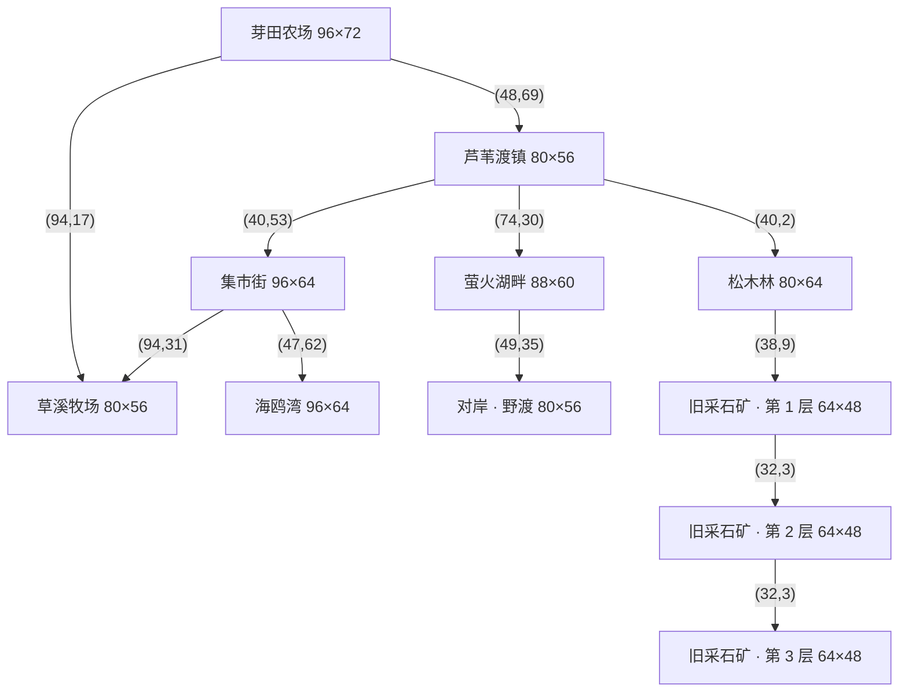

# 09 · 世界地图与路网

本文的表格由 `tools/world/build_map_doc.py` 从 `data/maps/` 生成。地图本身由 `tools/world/build_maps.py` 从零生成（每次运行都完整重写）。

## 1. 总连通图

所有地图通过真实的道路相连，每条边在两端各有一个出口站点（交互提示“北行 · 芦苇渡镇”之类）。

读法：**农场是中心，向南进镇；镇向北进山（林地与矿洞），向南进集市街，向东过桥到湖；集市街向东通牧场（牧场又有一条路直通农场），向南通海边。** 农场—镇—集市街—牧场构成一个闭环，不用走回头路。小镇到萤火湖畔的桥在主线阶段 3（修好东桥）之后才通。

## 2. 地图总表

| 地图 | 尺寸（格） | 地面 | 路面 | 树 | 采集点 | 装饰 | 站点 |
| --- | --- | --- | --- | --- | --- | --- | --- |
| 芽田农场 | 96×72 | 草地 | 土路 | 212 | 0 | 15 | 6 |
| 芦苇渡镇 | 80×56 | 草地 | 石板 | 90 | 0 | 34 | 9 |
| 集市街 | 96×64 | 草地 | 石板 | 60 | 0 | 118 | 13 |
| 草溪牧场 | 80×56 | 草地 | 土路 | 80 | 0 | 31 | 4 |
| 海鸥湾 | 96×64 | 沙滩 | 木栈道 | 24 | 22 | 25 | 3 |
| 松木林 | 80×64 | 草地 | 土路 | 270 | 24 | 12 | 3 |
| 萤火湖畔 | 88×60 | 草地 | 土路 | 110 | 10 | 9 | 4 |
| 对岸 · 野渡 | 80×56 | 草地 | 土路 | 80 | 20 | 7 | 2 |
| 旧采石矿 · 第 1 层 | 64×48 | 洞窟 | 土路 | 0 | 24 | 12 | 2 |
| 旧采石矿 · 第 2 层 | 64×48 | 洞窟 | 土路 | 0 | 24 | 13 | 2 |
| 旧采石矿 · 第 3 层 | 64×48 | 洞窟 | 土路 | 0 | 24 | 12 | 1 |
| 农舍 | 20×20 | 室内 | — | 0 | 0 | 0 | 5 |
| 玛戈的小酒馆 | 28×21 | 室内 | — | 0 | 0 | 0 | 3 |
| 卡弗木工坊 | 26×20 | 室内 | — | 0 | 0 | 0 | 4 |
| 霍克杂货店 | 24×18 | 室内 | — | 0 | 0 | 0 | 3 |
| 布兰尼根铁匠铺 | 24×20 | 室内 | — | 0 | 0 | 0 | 4 |
| 芦苇渡诊所 | 24×20 | 室内 | — | 0 | 0 | 0 | 3 |
| 铜壶茶室 | 22×18 | 室内 | — | 0 | 0 | 0 | 3 |
| 托比渔具店 | 20×17 | 室内 | — | 0 | 0 | 0 | 3 |
| 芦苇渡小学 | 26×19 | 室内 | — | 0 | 0 | 0 | 2 |
| 芦苇渡议事厅 | 26×21 | 室内 | — | 0 | 0 | 0 | 2 |
| 黑兹尔的种子小屋 | 18×21 | 室内 | — | 0 | 0 | 0 | 2 |
| 霍克家的家 | 22×27 | 室内 | — | 0 | 0 | 0 | 5 |
| 彭伯顿家的家 | 20×22 | 室内 | — | 0 | 0 | 0 | 3 |
| 费利克斯的钟表屋 | 18×20 | 室内 | — | 0 | 0 | 0 | 2 |
| 奎尔家的家 | 22×27 | 室内 | — | 0 | 0 | 0 | 4 |
| 阿玛拉的邮差小屋 | 18×20 | 室内 | — | 0 | 0 | 0 | 2 |
| 西奥的家 | 18×21 | 室内 | — | 0 | 0 | 0 | 2 |
| 德尔加多家的家 | 20×22 | 室内 | — | 0 | 0 | 0 | 3 |
| 约纳斯的林间小屋 | 18×20 | 室内 | — | 0 | 0 | 0 | 2 |
| 雷恩的观鸟小屋 | 18×20 | 室内 | — | 0 | 0 | 0 | 2 |
| 弗林家的海边住宅 | 20×22 | 室内 | — | 0 | 0 | 0 | 3 |
| 卡弗家的楼上 | 22×27 | 室内 | — | 0 | 0 | 0 | 4 |
| 酒馆楼上 · 住客走廊 | 22×27 | 室内 | — | 0 | 0 | 0 | 5 |
| 铁匠铺后宅 | 20×22 | 室内 | — | 0 | 0 | 0 | 3 |
| 诊所楼上 | 20×22 | 室内 | — | 0 | 0 | 0 | 3 |

## 3. 出口

| 从 | 站点 | 格 | 到 |
| --- | --- | --- | --- |
| 芽田农场 | 南行 · 芦苇渡镇 | (48,69) | 芦苇渡镇 |
| 芽田农场 | 东行 · 草溪牧场 | (94,17) | 草溪牧场 |
| 芽田农场 | 进入农舍 | (40,15) | 农舍 |
| 芽田农场 | 进入黑兹尔的种子小屋 | (30,17) | 黑兹尔的种子小屋 |
| 芦苇渡镇 | 西行 · 芽田农场 | (2,30) | 芽田农场 |
| 芦苇渡镇 | 北行 · 松木林 | (40,2) | 松木林 |
| 芦苇渡镇 | 南行 · 集市街 | (40,53) | 集市街 |
| 芦苇渡镇 | 进入玛戈的小酒馆 | (24,21) | 玛戈的小酒馆 |
| 芦苇渡镇 | 进入卡弗木工坊 | (54,21) | 卡弗木工坊 |
| 芦苇渡镇 | 进入芦苇渡小学 | (12,23) | 芦苇渡小学 |
| 芦苇渡镇 | 进入芦苇渡议事厅 | (30,14) | 芦苇渡议事厅 |
| 集市街 | 北行 · 芦苇渡镇 | (47,2) | 芦苇渡镇 |
| 集市街 | 东行 · 草溪牧场 | (94,31) | 草溪牧场 |
| 集市街 | 南行 · 海鸥湾 | (47,62) | 海鸥湾 |
| 集市街 | 进入霍克杂货店 | (16,26) | 霍克杂货店 |
| 集市街 | 进入布兰尼根铁匠铺 | (28,26) | 布兰尼根铁匠铺 |
| 集市街 | 进入芦苇渡诊所 | (66,26) | 芦苇渡诊所 |
| 集市街 | 进入铜壶茶室 | (80,26) | 铜壶茶室 |
| 集市街 | 进入霍克家的家 | (10,17) | 霍克家的家 |
| 集市街 | 进入彭伯顿家的家 | (24,17) | 彭伯顿家的家 |
| 集市街 | 进入费利克斯的钟表屋 | (36,17) | 费利克斯的钟表屋 |
| 集市街 | 进入奎尔家的家 | (60,17) | 奎尔家的家 |
| 集市街 | 进入阿玛拉的邮差小屋 | (72,17) | 阿玛拉的邮差小屋 |
| 集市街 | 进入西奥的家 | (84,17) | 西奥的家 |
| 草溪牧场 | 西北 · 芽田农场 | (1,8) | 芽田农场 |
| 草溪牧场 | 西行 · 集市街 | (1,25) | 集市街 |
| 草溪牧场 | 进入德尔加多家的家 | (14,17) | 德尔加多家的家 |
| 海鸥湾 | 北行 · 集市街 | (47,2) | 集市街 |
| 海鸥湾 | 进入托比渔具店 | (20,11) | 托比渔具店 |
| 海鸥湾 | 进入弗林家的海边住宅 | (70,11) | 弗林家的海边住宅 |
| 松木林 | 南行 · 芦苇渡镇 | (38,61) | 芦苇渡镇 |
| 松木林 | 进入旧采石矿 | (38,9) | 旧采石矿 · 第 1 层 |
| 松木林 | 进入约纳斯的林间小屋 | (46,50) | 约纳斯的林间小屋 |
| 萤火湖畔 | 进入雷恩的观鸟小屋 | (10,36) | 雷恩的观鸟小屋 |
| 萤火湖畔 | 西行 · 芦苇渡镇 | (2,29) | 芦苇渡镇 |
| 对岸 · 野渡 | 摆渡 · 萤火湖畔 | (4,44) | 萤火湖畔 |
| 旧采石矿 · 第 1 层 | 回到松木林 | (32,46) | 松木林 |
| 旧采石矿 · 第 1 层 | 向下 · 第 2 层 | (32,3) | 旧采石矿 · 第 2 层 |
| 旧采石矿 · 第 2 层 | 向上 · 第 1 层 | (32,46) | 旧采石矿 · 第 1 层 |
| 旧采石矿 · 第 2 层 | 向下 · 第 3 层 | (32,3) | 旧采石矿 · 第 3 层 |
| 旧采石矿 · 第 3 层 | 向上 · 第 2 层 | (32,46) | 旧采石矿 · 第 2 层 |
| 农舍 | 走出农舍 | (10,17) | 芽田农场 |
| 玛戈的小酒馆 | 回到镇上 | (9,18) | 芦苇渡镇 |
| 玛戈的小酒馆 | 进入酒馆楼上 · 住客走廊 | (21,17) | 酒馆楼上 · 住客走廊 |
| 卡弗木工坊 | 回到镇上 | (8,17) | 芦苇渡镇 |
| 卡弗木工坊 | 进入卡弗家的楼上 | (19,16) | 卡弗家的楼上 |
| 霍克杂货店 | 回到集市街 | (7,15) | 集市街 |
| 布兰尼根铁匠铺 | 回到集市街 | (7,17) | 集市街 |
| 布兰尼根铁匠铺 | 进入铁匠铺后宅 | (17,16) | 铁匠铺后宅 |
| 芦苇渡诊所 | 回到集市街 | (7,17) | 集市街 |
| 芦苇渡诊所 | 进入诊所楼上 | (17,16) | 诊所楼上 |
| 铜壶茶室 | 回到集市街 | (6,15) | 集市街 |
| 托比渔具店 | 回到海鸥湾 | (5,14) | 海鸥湾 |
| 芦苇渡小学 | 回到镇上 | (8,16) | 芦苇渡镇 |
| 芦苇渡议事厅 | 回到镇上 | (8,18) | 芦苇渡镇 |
| 黑兹尔的种子小屋 | 离开黑兹尔的种子小屋 | (7,18) | 芽田农场 |
| 霍克家的家 | 离开霍克家的家 | (11,24) | 集市街 |
| 彭伯顿家的家 | 离开彭伯顿家的家 | (10,19) | 集市街 |
| 费利克斯的钟表屋 | 离开费利克斯的钟表屋 | (7,17) | 集市街 |
| 奎尔家的家 | 离开奎尔家的家 | (11,24) | 集市街 |
| 阿玛拉的邮差小屋 | 离开阿玛拉的邮差小屋 | (7,17) | 集市街 |
| 西奥的家 | 离开西奥的家 | (7,18) | 集市街 |
| 德尔加多家的家 | 离开德尔加多家的家 | (10,19) | 草溪牧场 |
| 约纳斯的林间小屋 | 离开约纳斯的林间小屋 | (7,17) | 松木林 |
| 雷恩的观鸟小屋 | 离开雷恩的观鸟小屋 | (7,17) | 萤火湖畔 |
| 弗林家的海边住宅 | 离开弗林家的海边住宅 | (10,19) | 海鸥湾 |
| 卡弗家的楼上 | 离开卡弗家的楼上 | (11,24) | 卡弗木工坊 |
| 酒馆楼上 · 住客走廊 | 离开酒馆楼上 · 住客走廊 | (11,24) | 玛戈的小酒馆 |
| 铁匠铺后宅 | 离开铁匠铺后宅 | (10,19) | 布兰尼根铁匠铺 |
| 诊所楼上 | 离开诊所楼上 | (10,19) | 芦苇渡诊所 |

## 4. 站点（按 E 交互的地方）

| 地图 | 站点 | 类型 |
| --- | --- | --- |
| 芽田农场 | 黑兹尔的种子摊 | shop |
| 芽田农场 | 出售农产品 | shipping |
| 芦苇渡镇 | 旧木桥 · 萤火湖畔 | bridge |
| 芦苇渡镇 | 告示栏 | board |
| 草溪牧场 | 罗西的牧场 | shop |
| 萤火湖畔 | 灯台 | lantern |
| 萤火湖畔 | 摆渡 · 对岸野渡 | ferry |
| 对岸 · 野渡 | 旧灯龛 | story |
| 农舍 | 床 / 休息 | bed |
| 农舍 | 祖母的信 | letter |
| 农舍 | 厨房 / 烹饪 | kitchen |
| 农舍 | 储物箱 | storage |
| 玛戈的小酒馆 | 灶台 / 烹饪 | kitchen |
| 卡弗木工坊 | 建造台 | shop |
| 卡弗木工坊 | 木工作品 | inspect |
| 霍克杂货店 | 柜台 | shop |
| 霍克杂货店 | 今日到货 | inspect |
| 布兰尼根铁匠铺 | 柜台 | shop |
| 布兰尼根铁匠铺 | 锻炉 | inspect |
| 芦苇渡诊所 | 柜台 | shop |
| 铜壶茶室 | 柜台 | shop |
| 铜壶茶室 | 冲泡手记 | inspect |
| 托比渔具店 | 柜台 | shop |
| 托比渔具店 | 修网台 | inspect |
| 芦苇渡小学 | 孩子们的作业 | inspect |
| 芦苇渡议事厅 | 议事记录 | inspect |
| 黑兹尔的种子小屋 | 种子便签 | inspect |
| 霍克家的家 | 旧账簿 | inspect |
| 霍克家的家 | 菜市篮子 | inspect |
| 霍克家的家 | 学徒作品 | inspect |
| 霍克家的家 | 波比的画 | inspect |
| 彭伯顿家的家 | 镇长的旧地图 | inspect |
| 彭伯顿家的家 | 克拉拉的笔记 | inspect |
| 费利克斯的钟表屋 | 未走动的钟 | inspect |
| 奎尔家的家 | 奥黛特的针线篮 | inspect |
| 奎尔家的家 | 旧剧本 | inspect |
| 奎尔家的家 | 演出衣架 | inspect |
| 阿玛拉的邮差小屋 | 投递路线 | inspect |
| 西奥的家 | 教师书架 | inspect |
| 德尔加多家的家 | 牧场日记 | inspect |
| 德尔加多家的家 | 试茶记录 | inspect |
| 约纳斯的林间小屋 | 巡林图 | inspect |
| 雷恩的观鸟小屋 | 候鸟观察簿 | inspect |
| 弗林家的海边住宅 | 旧航海箱 | inspect |
| 弗林家的海边住宅 | 渡船票根 | inspect |
| 卡弗家的楼上 | 织机 | inspect |
| 卡弗家的楼上 | 木鸟 | inspect |
| 卡弗家的楼上 | 测绘图纸 | inspect |
| 酒馆楼上 · 住客走廊 | 酒馆菜单 | inspect |
| 酒馆楼上 · 住客走廊 | 小木船 | inspect |
| 酒馆楼上 · 住客走廊 | 旅行箱 | inspect |
| 酒馆楼上 · 住客走廊 | 县城来信 | inspect |
| 铁匠铺后宅 | 旧锻锤 | inspect |
| 铁匠铺后宅 | 矿井笔记 | inspect |
| 诊所楼上 | 医案 | inspect |
| 诊所楼上 | 压花册 | inspect |

站点类型：`inspect` 个人物件（查看）、`bed` 床（休息）、`letter` 祖母的信、`storage` 储物箱、`kitchen` 灶台、`shop` 柜台或摊位、`shipping` 收货箱、`board` 告示板、`bridge` 东桥、`lantern` 灯台、`ferry` 摆渡船（灯四亮后开放）、`story` 剧情地点（旧灯龛）。村民、采集点、鸡舍 / 谷仓门口是运行时加入的站点。

## 5. 装饰与碰撞

所有装饰烘焙进地形图，碰撞矩形由地图脚本同步写入，因此“看到的”和“撞到的”一致。

| 地图 | 装饰构成 |
| --- | --- |
| 芽田农场 | 木箱 ×1、围栏 ×2、路灯 ×9、盆栽 ×2、路牌 ×1 |
| 芦苇渡镇 | 木桶 ×1、围栏 ×10、花坛 ×2、干草垛 ×2、树篱 ×3、路灯 ×15、盆栽 ×1 |
| 集市街 | 木桶 ×8、木箱 ×8、围栏 ×41、花坛 ×22、树篱 ×4、路灯 ×22、盆栽 ×12、路牌 ×1 |
| 草溪牧场 | 木桶 ×1、推车 ×1、围栏 ×10、花坛 ×2、干草垛 ×6、路灯 ×5、盆栽 ×2、路牌 ×1、饮水槽 ×3 |
| 海鸥湾 | 木桶 ×3、木箱 ×2、围栏 ×6、花坛 ×1、路灯 ×10、岩石丛 ×3 |
| 松木林 | 干草垛 ×1、路灯 ×9、岩石丛 ×2 |
| 萤火湖畔 | 花坛 ×2、路灯 ×6、路牌 ×1 |
| 对岸 · 野渡 | 路灯 ×4、岩石丛 ×2、路牌 ×1 |
| 旧采石矿 · 第 1 层 | 木桶 ×1、木箱 ×1、路灯 ×9、岩石丛 ×1 |
| 旧采石矿 · 第 2 层 | 木桶 ×1、木箱 ×1、路灯 ×10、岩石丛 ×1 |
| 旧采石矿 · 第 3 层 | 木桶 ×1、木箱 ×1、路灯 ×9、岩石丛 ×1 |

## 6. 室内

25 张室内按用途采用不同尺寸。住宅包含个人卧室、走廊和共享起居室；营业场所包含前厅、营业区和后间。房门和楼梯双向连接；30 位村民回到真实房间，个人物件可按 E 查看。家具以独立精灵排序，地板和墙体由同一份平面图生成；大房间镜头跟随玩家。

## 7. 钓鱼水域

| 水域 | 对应地图 |
| --- | --- |
| 池塘 | 芽田农场、草溪牧场 |
| 河 | 芦苇渡镇 |
| 溪流 | 松木林 |
| 湖 | 萤火湖畔、对岸 · 野渡 |
| 海 | 海鸥湾 |
| 洞窟 | 旧采石矿 · 第 1 层、旧采石矿 · 第 2 层、旧采石矿 · 第 3 层 |
