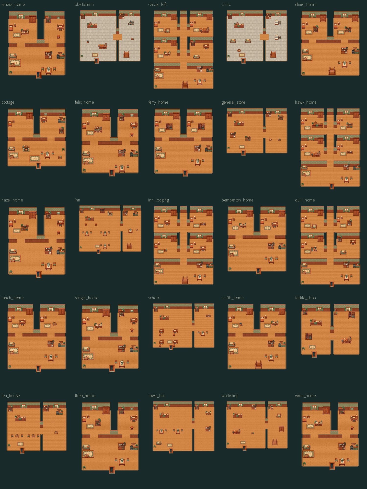

# 室内布局 · 当前进度快照

按用户要求停止制作并提交，**此版本不是验收完成版**。这些图来自当前地图数据与 v2 家具合成；运行时家具仍是独立对象，并未烘焙进地板。

25 张室内布局，另附 25 张碰撞叠图：红色表示阻挡格，青色表示交互点。布局与人物画风仍待后续接手者评估调整。

| 室内 | 地图格数 | 布局图 | 碰撞图 |
| --- | --- | --- | --- |
| 阿玛拉的邮差小屋 | 18 × 19 | [布局](amara_home.png) | [碰撞与交互点](amara_home-collision.png) |
| 布兰尼根铁匠铺 | 24 × 20 | [布局](blacksmith.png) | [碰撞与交互点](blacksmith-collision.png) |
| 卡弗家的楼上 | 22 × 27 | [布局](carver_loft.png) | [碰撞与交互点](carver_loft-collision.png) |
| 芦苇渡诊所 | 24 × 20 | [布局](clinic.png) | [碰撞与交互点](clinic-collision.png) |
| 诊所楼上 | 20 × 21 | [布局](clinic_home.png) | [碰撞与交互点](clinic_home-collision.png) |
| 农舍 | 20 × 19 | [布局](cottage.png) | [碰撞与交互点](cottage-collision.png) |
| 费利克斯的钟表屋 | 18 × 19 | [布局](felix_home.png) | [碰撞与交互点](felix_home-collision.png) |
| 弗林家的海边住宅 | 20 × 21 | [布局](ferry_home.png) | [碰撞与交互点](ferry_home-collision.png) |
| 霍克杂货店 | 24 × 18 | [布局](general_store.png) | [碰撞与交互点](general_store-collision.png) |
| 霍克家的家 | 22 × 27 | [布局](hawk_home.png) | [碰撞与交互点](hawk_home-collision.png) |
| 黑兹尔的种子小屋 | 18 × 20 | [布局](hazel_home.png) | [碰撞与交互点](hazel_home-collision.png) |
| 玛戈的小酒馆 | 28 × 21 | [布局](inn.png) | [碰撞与交互点](inn-collision.png) |
| 酒馆楼上 · 住客走廊 | 22 × 27 | [布局](inn_lodging.png) | [碰撞与交互点](inn_lodging-collision.png) |
| 彭伯顿家的家 | 20 × 21 | [布局](pemberton_home.png) | [碰撞与交互点](pemberton_home-collision.png) |
| 奎尔家的家 | 22 × 27 | [布局](quill_home.png) | [碰撞与交互点](quill_home-collision.png) |
| 德尔加多家的家 | 20 × 21 | [布局](ranch_home.png) | [碰撞与交互点](ranch_home-collision.png) |
| 约纳斯的林间小屋 | 18 × 19 | [布局](ranger_home.png) | [碰撞与交互点](ranger_home-collision.png) |
| 芦苇渡小学 | 26 × 19 | [布局](school.png) | [碰撞与交互点](school-collision.png) |
| 铁匠铺后宅 | 20 × 21 | [布局](smith_home.png) | [碰撞与交互点](smith_home-collision.png) |
| 托比渔具店 | 20 × 17 | [布局](tackle_shop.png) | [碰撞与交互点](tackle_shop-collision.png) |
| 铜壶茶室 | 22 × 18 | [布局](tea_house.png) | [碰撞与交互点](tea_house-collision.png) |
| 西奥的家 | 18 × 20 | [布局](theo_home.png) | [碰撞与交互点](theo_home-collision.png) |
| 芦苇渡议事厅 | 26 × 21 | [布局](town_hall.png) | [碰撞与交互点](town_hall-collision.png) |
| 卡弗木工坊 | 26 × 20 | [布局](workshop.png) | [碰撞与交互点](workshop-collision.png) |
| 雷恩的观鸟小屋 | 18 × 19 | [布局](wren_home.png) | [碰撞与交互点](wren_home-collision.png) |

## 生成来源

- 房间与通路：`tools/world/interior_plan.py`、`interior_layouts.py`、`public_interiors.py`。
- 家庭与个人陈设：`tools/world/residences.py`。
- 拼图：`tools/art/room_backgrounds.py`，运行 `.venv/bin/python tools/art/room_backgrounds.py --collisions`，输出到 `build/interior-previews/`。
- 独立家具：`assets/library/interiors/v2/`，当前运行时副本在 `assets/art/`。

## 交接状态

地图、内容生成与 Godot 无窗口导入通过。最新室内集成测试为 4940 项检查、3 项失败，分别是存入物品、存档后储物恢复、打开烹饪界面；退出还出现音频资源未释放提示。测试中使用的动作名 `store` 与实现的 `transfer` 不符，烹饪面板断言使用 `cooking` 而实现为 `kitchen`，这些测试尚未修正和复跑，不能据此宣称功能验证通过。

人物/道路比例阶段的测试已通过，但之后这批室内改动尚未完成完整窗口回归。`tests/scale_smoke.gd` 的农舍、酒馆固定坐标仍对应旧布局，后续应改为读取地图入口。部分早先文档和资产清单仍保留“尚未接入”或 v1 说明，应以当前代码、地图和本交接记录为准。

4K 生成缓存及原始裁切位于本机 `build/art-raw/`，未加入 Git；已提交可运行 PNG、固定风格参考图、来源清单与生成工具。资产验证脚本中依赖原始缓存的检查，干净克隆后不能直接通过，需补齐缓存或拆分运行时与来源验证。
